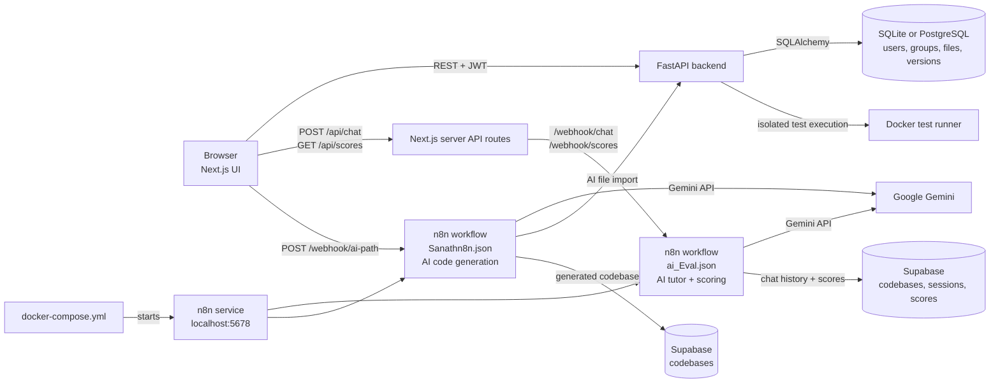
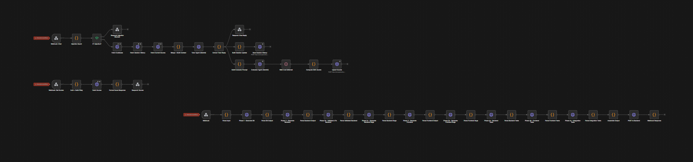

# glassBox - Workspace Collaboration Platform

A secure, modern platform for teams to collaborate on coding challenges, tests, and projects. glassBox allows admins to create groups, define custom fields for members, and share file templates with real-time editing capabilities.

## 🎯 Features

### For Group Admins
- ✅ Create workspaces/groups with custom member profiles
- ✅ Define custom fields for member information collection
- ✅ Create and manage file templates
- ✅ Generate coding challenges, bugged code, and tests with the n8n AI code-generation workflow
- ✅ View all member submissions and progress
- ✅ Admin dashboard with group analytics

### For Members
- ✅ Join groups with access codes
- ✅ Complete member profile forms
- ✅ Work on provided code challenges
- ✅ Get Socratic AI tutoring and reasoning feedback through n8n
- ✅ Submit independent file versions
- ✅ Real-time file editing and tracking

### Security Features
- ✅ **Strong password requirements** (10+ chars, uppercase, lowercase, digit, special)
- ✅ **JWT-based authentication** with 1-hour token expiration
- ✅ **Bcrypt password hashing** - industry standard with 12 rounds
- ✅ **SQL injection prevention** using parameterized queries (SQLAlchemy)
- ✅ **CORS protection** with configurable origins
- ✅ **Input validation** on all APIs (server-side)
- ✅ **Rate limiting** ready (with slowapi)
- ✅ **Comprehensive logging** for audit trails
- ✅ **Role-based access control** (admin vs member)

## 🏗️ Architecture



The n8n services are started by [`docker-compose.yml`](./docker-compose.yml).
The workflow exports shown above are [`Sanathn8n.json`](./Sanathn8n.json) for
AI-generated coding challenges and [`ai_Eval.json`](./ai_Eval.json) for tutor
chat and evaluation.

## 🚀 Quick Start

**Prerequisites**: Python 3.10+, Node.js 18+

### Backend (Terminal 1)
```bash
cd backend
python -m venv venv
source venv/bin/activate  # or venv\Scripts\activate on Windows
pip install -r requirements.txt
cp .env.example .env
uvicorn main:app --reload --host 0.0.0.0 --port 8000
```

Backend at: http://localhost:8000 (API docs at `/docs`)

### Frontend (Terminal 2)
```bash
cd frontend
npm install
cp .env.example .env.local
npm run dev
```

Frontend at: http://localhost:3000

**See [QUICKSTART.md](./QUICKSTART.md) for detailed setup instructions.**

## 🔄 n8n Workflows

n8n powers the AI code-generation, tutoring, and scoring features. The core
frontend and backend can run without n8n, but those AI features require it.

The workflow overview below shows how the imported n8n workflows are organized:



### Start n8n

Install and start Docker Desktop. In the repository root, create a local
`.env` file containing your Gemini API key:

```env
GEMINI_KEY=your_gemini_api_key
```

The root `.env` file is ignored by Git. Start n8n from the repository root:

```powershell
docker compose up -d n8n
docker compose logs -f n8n
```

Open [http://localhost:5678](http://localhost:5678) and finish n8n's initial
setup.

### Import and activate the workflows

In n8n, use **Import from File** to import each workflow, configure the
referenced **Supabase account** credential on its Supabase nodes, then activate
the workflows. Active workflows use the production `/webhook/` URLs below.

| Workflow file | Webhook | Purpose |
| --- | --- | --- |
| [Sanathn8n.json](./Sanathn8n.json) | `POST /webhook/ai-path` | Generates a database sample, backend and frontend code, and tests for a group; stores the generated codebase in Supabase. |
| [ai_Eval.json](./ai_Eval.json) | `POST /webhook/chat` | Provides the AI coding tutor and evaluates debugging prompts, saving session and score data in Supabase. |
| [ai_Eval.json](./ai_Eval.json) | `GET /webhook/scores` | Returns a member's saved evaluation scores. |

Both workflows call Gemini using `GEMINI_KEY` and use Supabase nodes. Configure
valid Gemini and Supabase credentials before running them. The `.env` file is
for local development only; never commit API keys. If a key was previously
committed or shared, revoke it and use a newly generated key.

### Connect the frontend

Ensure `frontend/.env.local` contains the following URLs (they are also in
[frontend/.env.example](./frontend/.env.example)):

```env
NEXT_PUBLIC_N8N_WEBHOOK_URL=http://localhost:5678/webhook/ai-path
N8N_WEBHOOK_URL=http://localhost:5678/webhook
```

Restart `npm run dev` after changing environment variables. The current
workflow exports provide `/ai-path`, `/chat`, and `/scores`; they do **not**
provide `/init-session`, which the frontend also calls. That feature requires
an additional n8n endpoint/workflow.

## 📚 API Documentation

### Authentication
- `POST /api/auth/register` - Register new user
- `POST /api/auth/login` - Login user
- `GET /api/auth/me` - Get current user

### Groups
- `POST /api/groups` - Create group
- `GET /api/groups` - List user's groups
- `GET /api/groups/{id}` - Get group details
- `POST /api/groups/join` - Join group with code
- `DELETE /api/groups/{id}` - Delete group (admin)

### Files
- `POST /api/groups/{id}/files` - Create file (admin)
- `GET /api/groups/{id}/files` - List group files
- `PUT /api/groups/{id}/files/{file_id}` - Update file (admin)
- `DELETE /api/groups/{id}/files/{file_id}` - Delete file (admin)

### Member Files
- `GET /api/groups/{id}/files/{file_id}/my-version` - Get your file copy
- `PUT /api/groups/{id}/files/{file_id}/my-version` - Update your copy
- `GET /api/groups/{id}/files/{file_id}/versions` - View all versions (admin)

**Full API docs at**: http://localhost:8000/docs (Swagger UI)

## 🔐 Security Implementation

### Password Policy
- Minimum 10 characters
- Must include uppercase, lowercase, digit, special character
- Examples of valid passwords:
  - `SecurePass123!`
  - `MyP@ssw0rd`
  - `Tr0p!cal$unset`

### Authentication Flow
1. User registers/logs in
2. Server validates credentials and password strength
3. Server generates JWT token (valid for 1 hour)
4. Client stores token in localStorage
5. Client includes token in Authorization header for API calls

### Input Validation
- **Username**: 3-50 chars, alphanumeric + underscore/hyphen
- **Email**: RFC compliant format, max 100 chars
- **Group Name**: Max 100 chars
- **File Content**: Max 10 MB
- **All inputs**: Validated server-side (never trust client)

### Database Security
- All queries use parameterized statements (prevents SQL injection)
- Passwords hashed with bcrypt (not reversible)
- User emails indexed for unique constraint
- CORS limited to configured origins

**See [SECURITY.md](./SECURITY.md) for comprehensive security details.**

## 🚢 Deployment

### Development
```bash
# Run both servers with auto-reload
# Backend: uvicorn main:app --reload --host 0.0.0.0 --port 8000
# Frontend: npm run dev
```

### Production Checklist
- [ ] Set strong `SECRET_KEY` environment variable
- [ ] Configure `CORS_ORIGINS` to your domain
- [ ] Use PostgreSQL (not SQLite)
- [ ] Enable HTTPS/SSL
- [ ] Set secure environment variables
- [ ] Keep dependencies updated
- [ ] Set up monitoring and logging
- [ ] Implement backups

**See [DEPLOYMENT.md](./DEPLOYMENT.md) for production setup.**

## 🛠️ Tech Stack

### Backend
- **FastAPI** - Modern Python web framework
- **SQLAlchemy** - ORM for database operations
- **Pydantic** - Data validation
- **JWT** - Token-based authentication
- **Bcrypt** - Password hashing

### Frontend
- **Next.js 16** - React framework
- **React 19** - UI library
- **JavaScript/CSS** - Styling

### Database
- **SQLite** - Development (fast, no setup)
- **PostgreSQL** - Production (recommended)

## 📊 Data Models

### User
```python
- id: int (primary key)
- username: str (unique, 3-50 chars)
- email: str (unique, validated)
- hashed_password: str (bcrypt)
- created_at: datetime
```

### Group
```python
- id: int (primary key)
- name: str (max 100 chars)
- description: str (max 500 chars)
- group_code: str (unique, 8 chars)
- admin_id: int (foreign key)
- created_at: datetime
```

### GroupFile
```python
- id: int (primary key)
- group_id: int (foreign key)
- filename: str (max 255 chars)
- language: str (text, python, javascript, etc.)
- content: str (max 10MB)
- created_at: datetime
```

### MemberFileVersion
```python
- id: int (primary key)
- file_id: int (foreign key)
- user_id: int (foreign key)
- content: str (member's edited version)
- updated_at: datetime
```

## 🧪 Testing

### Manual Testing
1. Register with a valid password: `TestPass123!`
2. Create a group and get the access code
3. Join from another account using the code
4. Create a file template
5. Submit your file edits
6. View all versions as admin

### Automated Testing
```bash
# Backend
cd backend
pip install pytest
pytest

# Frontend
cd frontend
npm test
```

## 📝 Environment Variables

### Backend (.env)
```
SECRET_KEY=your-secret-key-here
DATABASE_URL=sqlite:///./glassBox.db
CORS_ORIGINS=http://localhost:3000
ACCESS_TOKEN_EXPIRE_MINUTES=60
LOG_LEVEL=INFO
```

### Frontend (.env.local)
```
NEXT_PUBLIC_API_URL=http://localhost:8000/api
```

## 🐛 Troubleshooting

### Backend Won't Start
```bash
# Check Python version (need 3.10+)
python --version

# Check dependencies
pip install -r requirements.txt --upgrade

# Check port (8000 in use?)
lsof -i :8000
```

### Frontend Won't Start
```bash
# Clear cache
rm -rf .next node_modules

# Reinstall dependencies
npm install

# Check Node version (need 18+)
node --version
```

### "Invalid credentials" on login
- Ensure email matches registration email
- Passwords are case-sensitive
- Try re-registering if issues persist

### Token expiration
- Tokens expire after 1 hour
- Page will redirect to login automatically
- Re-login to get new token

## 📚 Documentation

- [QUICKSTART.md](./QUICKSTART.md) - Get started in 5 minutes
- [SECURITY.md](./SECURITY.md) - Security detailed documentation
- [DEPLOYMENT.md](./DEPLOYMENT.md) - Production deployment guide
- [API Docs](http://localhost:8000/docs) - Interactive API documentation

## 🤝 Contributing

1. Create feature branch: `git checkout -b feature/amazing-feature`
2. Commit changes: `git commit -m 'Add amazing feature'`
3. Push to branch: `git push origin feature/amazing-feature`
4. Open Pull Request

## 📄 License

This project is licensed under the MIT License - see LICENSE file for details.

## 🎓 Learning Resources

- [FastAPI Security](https://fastapi.tiangolo.com/tutorial/security/)
- [OWASP Top 10](https://owasp.org/www-project-top-ten/)
- [JWT Best Practices](https://tools.ietf.org/html/rfc8725)
- [Next.js Documentation](https://nextjs.org/docs)

## ⭐ Features Roadmap

- [ ] Two-factor authentication (2FA)
- [ ] Social login (OAuth2)
- [ ] File version history/rollback
- [ ] Real-time collaboration (WebSockets)
- [ ] Advanced search and filtering
- [ ] Export results as CSV/PDF
- [ ] Integration with GitHub
- [ ] Custom branding for groups
- [ ] Team management
- [ ] API rate limiting
- [ ] Webhook support

## 📞 Support

For issues, questions, or feature requests:
1. Check existing documentation
2. Review error logs
3. Create GitHub issue with details

---

**Happy collaborating! 🚀**

Last Updated: March 28, 2026
